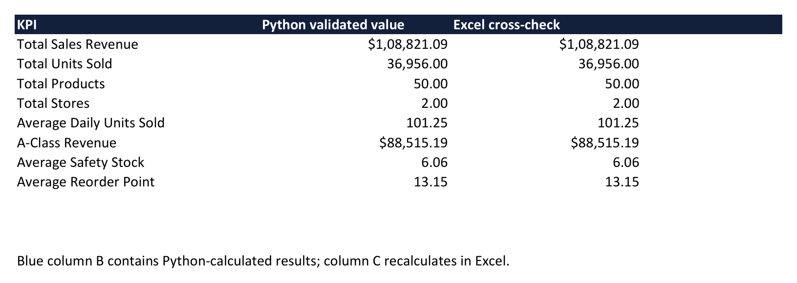
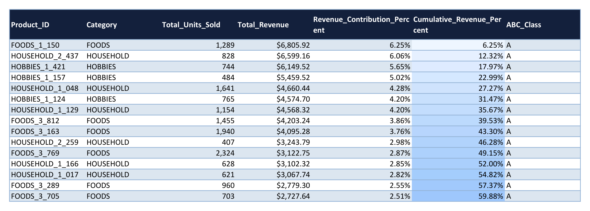
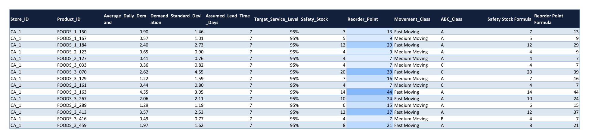
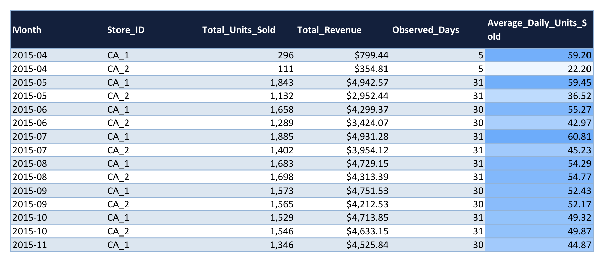
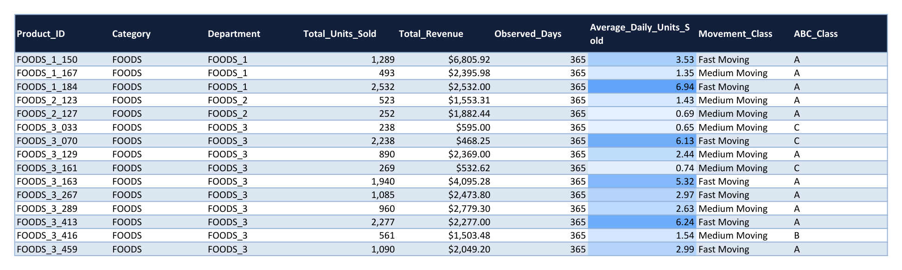
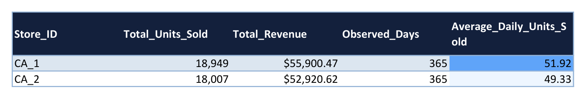

# Retail Demand & Inventory Analytics

An end-to-end data analytics project combining **Python**, **Microsoft Excel**, and **Power BI** to analyze retail sales patterns, categorize inventory performance, and calculate replenishment thresholds.

---

## Overview

Managing inventory effectively requires understanding both customer demand and supply lead times. This project analyzes real-world historical sales data from the **Walmart M5 dataset** across **50 products** and **2 stores** (`CA_1` and `CA_2`) over a **365-day period** (April 26, 2015 – April 24, 2016).

Using 36,500 daily sales records, the project automates data cleaning, performs ABC revenue segmentation, tracks sales velocity, and models safety stock and reorder points for retail inventory planning.

---

## Tools Used

- **Python (pandas, NumPy, openpyxl)**: Data ingestion, cleaning, statistical modeling, and automated Excel report generation.
- **Microsoft Excel**: Multi-tab analytical workbook featuring dynamic formulas, KPI cross-checks, and sensitivity analysis.
- **Power BI Desktop**: Interactive reporting with star schema data modeling, Power Query transformations, and DAX measures.

---

## Project Previews

### 1. Executive KPI Summary
Tracks headline revenue, total volume sold, store counts, and baseline inventory thresholds.



### 2. ABC Revenue Classification
Ranks items by total revenue to separate high-value drivers from long-tail inventory.



### 3. Inventory Planning & Replenishment
Calculates daily demand variation, safety stock buffers, and reorder points for each product-store pair.



### 4. Monthly Sales Trends
Monitors monthly revenue and sales velocity across retail locations.



### 5. Product Performance & Velocity
Categorizes products by movement speed (Fast, Medium, Slow) alongside unit volume and department.



### 6. Store Performance Comparison
Compares unit sales, revenue generation, and daily volume between Store `CA_1` and Store `CA_2`.



---

## How the Project Works

```text
Raw Walmart M5 CSVs 
       ↓
Python Data Cleaning & Pipeline (scripts/prepare_data.py)
       ↓
Cleaned Dimensional Data (data/processed/)
       ↓
┌─────────────────────────────────┴─────────────────────────────────┐
↓                                                                   ↓
Automated Excel Model                                   Power BI Star Schema Model
(excel/Retail_Inventory_Analysis.xlsx)                  (powerbi/Retail_Demand_Inventory_Analytics.pbip)
• 8 Interconnected Sheets                               • 3 Interactive Dashboard Pages
• Dynamic Formulas & Sensitivity                        • Custom DAX Measures & Star Schema
```

---

## Key Metrics & Findings

| Metric | Value | Description |
| :--- | :--- | :--- |
| **Total Sales Revenue** | **$108,821.09** | Total revenue generated across all 50 products and 2 stores |
| **Total Units Sold** | **36,956 units** | Total quantity sold across 365 days |
| **Average Daily Sales** | **101.25 units/day** | Average units sold per day across both stores |
| **Store CA_1 Revenue** | **$55,900.47** | 18,949 units sold (51.4% of total revenue) |
| **Store CA_2 Revenue** | **$52,920.62** | 18,007 units sold (48.6% of total revenue) |
| **Top Revenue Product** | **FOODS_1_150** | Generated $6,805.92 with 1,289 units sold |
| **A-Class Revenue Share** | **81.34% ($88,515.19)** | Generated by top 26 priority products |
| **Average Safety Stock** | **6.06 units** | Mean safety stock recommended per product-store pair |
| **Average Reorder Point** | **13.15 units** | Mean reorder threshold across product-store pairs |

---

## Core Concepts Made Simple

### 1. ABC Revenue Analysis (Pareto Principle)
Products are grouped based on their contribution to total revenue:
- **Class A (Top ~80% of revenue)**: High-value products that drive the business. These require tight stock control and frequent review.
- **Class B (Next ~15% of revenue)**: Moderate-value products with steady, dependable sales.
- **Class C (Bottom ~5% of revenue)**: Low-revenue products. These can be managed with simpler periodic ordering rules.

### 2. Product Sales Velocity
Products are classified by daily unit sales across a 365-day baseline:
- **Fast Moving**: Top 25% of products by daily volume (≥ 2.66 units/day).
- **Medium Moving**: Middle 50% of products (between 0.58 and 2.66 units/day).
- **Slow Moving**: Bottom 25% of products (≤ 0.58 units/day).

### 3. Safety Stock
Safety stock is the buffer inventory held to protect against unexpected spikes in customer demand or supplier delivery delays:

$$\text{Safety Stock} = \lceil Z \times \sigma_{\text{daily}} \times \sqrt{\text{Lead Time}} \rceil$$

- **$Z$ (Service Factor)**: $1.645$ corresponds to a 95% target service level.
- **$\sigma_{\text{daily}}$**: Standard deviation of daily sales for the product.
- **$\text{Lead Time}$**: Baseline supplier delivery time (assumed as 7 days).

### 4. Reorder Point (ROP)
The reorder point tells the store manager exactly when to place a new purchase order before stock runs out:

$$\text{Reorder Point} = \lceil (\text{Average Daily Demand} \times \text{Lead Time}) + \text{Safety Stock} \rceil$$

---

## Project Structure

```text
├── data/
│   ├── raw/                 # Original Walmart M5 dataset files
│   └── processed/           # Cleaned sales data, dimension tables, and summaries
├── excel/
│   └── Retail_Inventory_Analysis.xlsx   # Complete 8-sheet Excel model with formulas
├── powerbi/
│   ├── Retail_Demand_Inventory_Analytics.pbip   # Power BI Project definition
│   ├── DAX_measures.dax                         # DAX formulas used in reports
│   └── POWER_BI_SETUP.md                        # Power BI configuration guide
├── reports/
│   ├── business_insights.md         # Detailed narrative analysis and observations
│   └── data_validation_report.md    # Automated reconciliation tests
├── screenshots/             # High-resolution previews for documentation
├── scripts/
│   ├── download_data.py     # Downloads source data and verifies checksums
│   ├── prepare_data.py      # Cleans, reshapes, and exports CSV datasets
│   ├── build_excel.py       # Generates formatted Excel workbook with formulas
│   ├── build_powerbi.py     # Configures Power BI data model and layouts
│   └── run_all.py           # Runs the entire pipeline sequentially
└── requirements.txt         # Required Python packages
```

---

## How to Run

### 1. Set Up Python Environment

Open PowerShell or a terminal in the project directory:

```powershell
# Create and activate virtual environment
python -m venv .venv
.\.venv\Scripts\activate

# Install required packages
pip install -r requirements.txt
```

### 2. Run the Full Data Pipeline

Run the automated runner to download the dataset, process the sales tables, build the Excel model, and generate validation reports:

```powershell
python scripts/run_all.py
```

Or run individual steps as needed:

```powershell
python scripts/download_data.py
python scripts/prepare_data.py
python scripts/validate_data.py
python scripts/build_excel.py
python scripts/write_insights.py
python scripts/build_powerbi.py
```

### 3. Open the Reports

- **Excel**: Open `excel/Retail_Inventory_Analysis.xlsx` to view all 8 worksheets, explore dynamic formula recalculations, and test lead-time sensitivity.
- **Power BI**: Open `powerbi/Retail_Demand_Inventory_Analytics.pbip` in Power BI Desktop and click **Refresh** to load the dataset into the interactive visual report.
